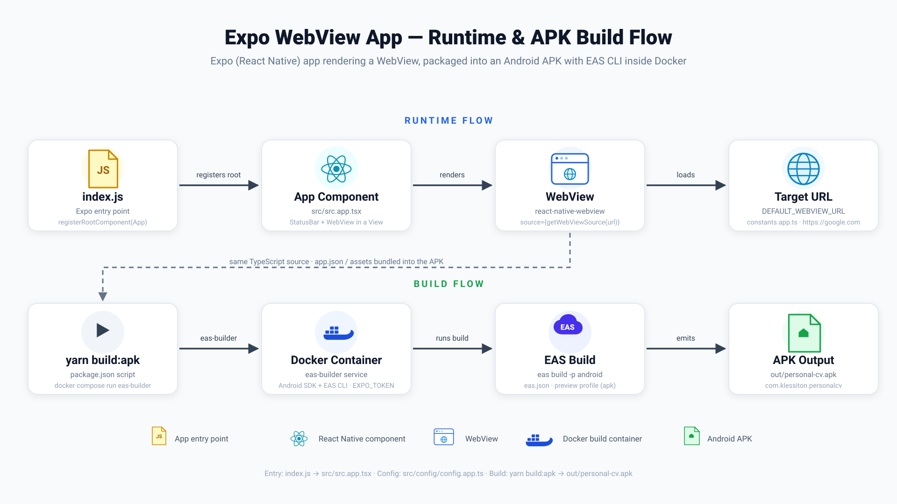

# expo-webview-release

## Description

Expo (React Native) app that renders a WebView pointing to a configured URL (default `https://google.com`). The TypeScript source is kept minimal — a root App component with config, constants, and WebView helpers — and the Android APK is built with EAS CLI inside a Docker container (Android SDK + EAS CLI image), emitted to `out/personal-cv.apk`.

## Clone as submodule (https)

```bash
# add this repo as a submodule in a parent project
git submodule add https://github.com/KlessitonRodrigues/expo-webview-release.git

# commit the submodule reference in the parent repo
git commit -m "feat: add expo-webview-release submodule"

# clone a parent repo with this submodule included
git clone --recurse-submodules https://github.com/<parent-owner>/<parent-repo>.git

# or initialize submodules after an existing clone
git submodule update --init --recursive
```

## Diagram



## Structure

```
.
├── assets/                          # App icon and splash screen images
│   ├── icon.png
│   ├── adaptive-icon.png
│   ├── splash.png
│   └── favicon.png
├── src/
│   ├── src.app.tsx                  # Root App component (WebView)
│   ├── config/
│   │   └── config.app.ts            # App configuration
│   ├── constants/
│   │   └── constants.app.ts         # Default WebView URL and styles
│   └── utils/
│       └── utils.webview.ts         # WebView helpers
├── index.js                         # Expo entry point (registerRootComponent)
├── app.json                         # Expo app config (icon/splash/assets refs)
├── eas.json                         # EAS build profiles (preview = apk)
├── Dockerfile                       # Android SDK + EAS CLI builder image
├── docker-compose.yml               # eas-builder service
├── package.json                     # Root package manifest
├── tsconfig.json                    # TypeScript configuration
├── .prettierrc                      # Prettier configuration
├── .gitignore                       # Git ignore rules
└── yarn.lock                        # Lockfile
```

## Usage

```bash
# local dev
yarn install
yarn start

# docker container (keep running)
yarn start-container
yarn stop-container

# build APK with docker -> emits out/personal-cv.apk
yarn build:apk
```

## Requirements

- Docker running
- `EXPO_TOKEN` exported in the shell (used by docker-compose for EAS auth)
- EAS credentials at `~/.eas` (persisted via volume)

See `AGENTS.md` for code conventions.
